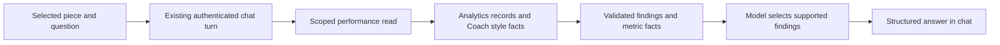

# Selected piece performance build plan

Status: SPP-01 through SPP-04 accepted, 2026-10-23. Sol planned, Luna implemented, and the supervisor reviewed and independently verified the subject/evidence contract before chat integration, followed by findings, interpretation, saved history and the mounted product journey. See [SPP-01 acceptance](SPP-01-IMPLEMENTATION.md), [SPP-02 acceptance](SPP-02-IMPLEMENTATION.md), [SPP-03 acceptance](SPP-03-IMPLEMENTATION.md) and [SPP-04 acceptance and host zoom limitation](SPP-04-IMPLEMENTATION.md). Scope: one selected piece, a natural-language performance question, and an answer grounded in the creator's stored analytics. The feature remains off by default. Deployment, live-account coverage and paid model evaluation remain separate.

Follow-up: the feature is now enabled in the ignored local configuration. The [local verification record](SPP-LOCAL-VERIFICATION.md) documents a successful real-provider no-data turn against an existing pilot post. A comparison with a real creator's nonempty analytics still needs the intended account/data source.

The creator adds a piece to chat and asks, "How is it performing?" Relay identifies the selected subject, returns the recorded metrics by platform, explains what those figures support, and shows when they were captured. Missing observations remain visible. Asking about performance preserves pending edits and creates no publishing work.

## Product scope

The first slice includes:

- One explicitly selected Relay Post or Work/Bundle. A Work/Bundle includes its server-resolved member posts; a post selection stays scoped to that post.
- The existing rolling `7d`, `30d`, and `90d` reporting ranges, defaulting visibly to `30d`. Latest captured counters are labeled separately from changes within that window.
- Recorded impressions, seen events, views, likes, and comments where supported by the source. Platform rows retain their native metric names.
- Short factual findings, missing-data explanations, and links to the existing analytics inspector.
- Ordinary chat entry, including "How is this doing?" and "How is it performing on X?" An optional suggested question may submit through the same path.
- A metrics-only answer when evidence was loaded but AI synthesis fails or is rejected.

Live platform refresh, automatic polling, account-wide analysis, comparisons between separately selected pieces, arbitrary date ranges, follower/revenue/conversion claims, causal explanations, new goals, and publishing actions are outside this slice. It introduces no new analytics tables, scheduler, credits product, or agent framework. A heavier model is not a dependency.

This is an additive contract alongside [Product connections for the conversational gallery editor](PRODUCT-CONVERSATION-CONNECTION-PLAN.md), whose six connector tickets exclude engagement metrics. Their accepted status and deferred product-mount checks remain unchanged. Escape Hatch stays deferred. [Goal Cycle](../studio/GOAL_CYCLE_PRODUCT_CONTRACT.md) continues to own planning credits and Goal Cycle execution; a performance question does not create a Goal Cycle or consume its Plan credit.

## Existing architecture and reuse

| Existing module | Reuse | Limit to address in this slice |
|---|---|---|
| [`performance-intelligence-read.ts`](../../src/analytics/performance-intelligence-read.ts) | Owned work/post resolution, member and platform structure, range handling, daily series, source-confidence helper | Rollup totals and freshness alone cannot prove a latest captured counter or complete observation coverage. |
| [`creator-unified-performance.ts`](../../src/analytics/creator-unified-performance.ts) | Existing rollup reads and aggregation semantics | Aggregation uses `deltaFromPrior`, falling back to absolute `value` for a first observation. A first observation inside a window is not proof that all activity occurred inside it. |
| [`external-post-metrics-service.ts`](../../src/distribution/external-post-metrics-service.ts) | Snapshot provenance, captured times, source labels, and Patreon CSV overlay rules | `getPostExternalMetrics` is attempt-oriented. It does not by itself cover every instance-linked snapshot, unlinked CSV row, or Relay-native observation. |
| [`coach-fact-pack.ts`](../../src/distribution/coach-fact-pack.ts) | Deterministic fact preparation, reason codes, coverage reporting, and bounded model context | Its fixed 30-day range, creator-wide coverage, capped comparisons, and omission of all-zero post summaries are unsuitable as the authority for this answer. |
| [`coach-propose-service.ts`](../../src/distribution/coach-propose-service.ts) | Evidence-first generation and deterministic fallback pattern | Do not invoke copy generation or return its creator-wide recommendations as findings about this piece. |
| [`gallery-editor`](../../src/gallery-editor/intent.ts) | Existing authenticated turn, read-tool loop, configured provider, spending budget, cancellation, and session ownership | Add a typed performance result. The current turn finishes through cart revision; an answer must retain the cart unchanged. |
| [`platform-instance-refresh-service.ts`](../../src/analytics/platform-instance-refresh-service.ts) | Refresh eligibility and existing inspector behavior | A question never starts a refresh. `completed` can mean rollup recomputation or CSV overlay, without newer platform observations. |

Add a focused `buildPiecePerformanceFacts` module near the existing analytics/Coach modules. Compose the owned reads above and add the missing observation projection over existing records. Share a small helper with Coach only when both callers actually need identical semantics; keep existing Coach output compatible. Do not fix creator-wide analytics or rewrite the existing fact pack as a side effect.



## Input contract

Extend the existing `POST /api/v1/gallery/editor/sessions/:id/turn` contract registered in [`routes.ts`](../../src/gallery-editor/routes.ts). Keep its existing API envelope and legacy editing requests compatible; no parallel chat endpoint is needed.

```ts
type PerformanceSubjectRef =
  | { kind: "post"; id: string }
  | { kind: "work"; id: string };

type TurnRequest = {
  revision: number; // Existing session revision.
  message: string; // Existing natural-language input.
  context: EditorContext; // Existing selectedPostIds and other context.
  performanceSubject?: PerformanceSubjectRef; // New optional selection hint.
};

type PiecePerformanceReadArgs = {
  range: "7d" | "30d" | "90d";
  destination: string | null; // Exact supported destination, or all linked destinations.
};
```

`performanceSubject` describes the chip the creator selected. It is not permission to read an object. Validate exact subject keys, trimmed IDs of 1 to 200 characters, account/creator/Tenant ownership, and consistency with the submitted selection. A post must be selected. A work must be explicitly represented as a work selection and contain the selected anchor post; load its complete owned membership on the server. Never promote a post to its work because it happens to have siblings. Do not trust client titles, member lists, platform links, counters, or creator IDs.

When the hint is absent, exactly one distinct selected post resolves to post scope. Multiple media from that post count as one post. Zero posts or multiple posts require a selection clarification if the question invokes performance, even when those posts share a work. An explicit work chip is required for work scope. Existing multi-post edit behavior stays available. An attached file or draft without a resolved Library subject has no collected publishing performance.

The model receives a `readPiecePerformance` read tool whose arguments contain only range and destination. It cannot supply an object ID, URL, SQL, creator, metric value, or refresh instruction. Bind the tool to the authenticated subject frozen for this submitted turn. Selection changes in the browser affect the next turn.

Use semantic intent handling in the existing interpreter. Do not depend on a phrase allowlist for "How is it performing?" Extend the active legacy/compiled schemas and tool whitelist explicitly. A requested unsupported period, platform, peer comparison, or combined analytics-and-mutation request returns a clarification/limitation for the whole request; it must not silently drop a clause. A missing period uses the displayed 30-day default. Explicitly requested periods must match the normalized range or prompt clarification.

Preserve the editor's existing message bound and transport parser. Cap the new hint at one subject. Authentication, capability checks, and session revision validation occur before provider work. Add `performance: { enabled: boolean; aiAvailable: boolean }` to the existing capabilities response. Keep the capability off by default behind `RELAY_GALLERY_EDITOR_PERFORMANCE_ENABLED=1` and the existing editor creator allowlist. With it off, omit the new tool/result branch and preserve existing editing behavior. Capability checks disclose no credentials or pricing configuration.

## Output contract

Keep the existing `EditorSession` response. Add optional `performanceAnswer` to an assistant `EditorMessage`; existing messages retain `{role, text}`. Set `text` to the server-rendered readable answer so older clients can still display it. The structured payload is authoritative for metric cards and evidence disclosure.

```ts
type MetricName = "impressions" | "seen" | "views" | "likes" | "comments";
type EvidenceRef = {
  kind: "snapshot" | "csv_metric" | "daily_rollup" | "relay_aggregate";
  id: string; // Owned record ID, or reproducible aggregate reference.
  observed_at: string | null; // Source observation time, never response generation time.
};

type MetricFact = {
  id: string; // Unique within this answer.
  post_id: string;
  destination: string;
  metric: MetricName;
  basis: "captured_total" | "window_change";
  value: number | null;
  availability: "available" | "unavailable";
  unavailable_reason: "not_collected" | "unknown_period" | "ambiguous_link"
    | "incomplete_baseline" | "source_unavailable" | null;
  source: string | null;
  confidence: "high" | "medium" | "low" | "unknown";
  captured_at: string | null;
  computed_at: string | null;
  stale: boolean;
  evidence: EvidenceRef[];
};

type PerformanceFinding = {
  id: string;
  code: "recorded_activity" | "recorded_change" | "response_observed"
    | "reach_without_recorded_response" | "coverage_gap" | "stale_observations";
  text: string; // Rendered from a server-owned finding template.
  metric_fact_ids: string[];
  coverage_refs: string[];
};

type PiecePerformanceAnswer = {
  v: 1;
  kind: "piece_performance";
  report_id: string;
  status: "complete" | "partial" | "no_data";
  subject: { kind: "post" | "work"; id: string; title: string; post_ids: string[] };
  as_of: string; // Server read cutoff in UTC.
  range: "7d" | "30d" | "90d";
  time_range: { start: string; end: string }; // Existing UTC range resolver.
  destination: string | null;
  metrics: MetricFact[];
  coverage: Array<{
    id: string;
    post_id: string;
    destination: string;
    state: "observed" | "partial" | "no_observations" | "unlinked" | "unavailable";
    missing_metrics: MetricName[];
  }>;
  source_failures: Array<"snapshots" | "csv" | "relay_events">;
  findings: PerformanceFinding[];
  summary: string;
  synthesis: {
    status: "ai_selected" | "deterministic";
    reason: "no_data" | "provider_unavailable" | "invalid_output" | "budget"
      | "timeout" | null;
  };
  links: Array<{ kind: "view_analytics"; href: string }>;
};
```

All timestamps are ISO UTC strings and observed counters are nonnegative safe integers. Validate metric/source names and every referenced fact/coverage ID. An available zero has `value: 0`, `unavailable_reason: null`, and evidence. Unavailable values have `value: null` and a reason. Source/confidence and capture times belong to each fact; a newer observation for X must not make old Patreon data appear current.

`complete` means every metric in the server-defined applicable metric set for the resolved scope and basis was supplied. Derive that set from the existing collectors' documented capabilities; do not infer support from whether a row exists. It does not mean every platform exposes every metric. `partial` means at least one fact is available and a required observation/period is missing or unavailable. `no_data` means successful scoped reads found no usable facts. Stale facts remain available with an explicit warning. A read failure is not an empty-success report: use `partial` only when another section succeeded, otherwise return the existing unavailable error envelope. Never expose foreign ownership through a different not-found response.

Treat missing selection, unsupported scope, and unsupported question as the existing clarification/limitation outcome with a concise explanation and no `performanceAnswer`. A stale session or changed subject membership returns a conflict with no new answer saved. Feature-disabled, authentication, and total analytics failures retain the existing HTTP error-envelope conventions. Never substitute a performance result for a failed authorization check. Validate the stored/output payload on session read-back as well as creation; a malformed structured attachment must not become trusted evidence.

Persist an accepted answer in the existing session `messages` JSON using the existing message retention limit. No new table is required. On reload, retain the original subject and `as_of`; history is a saved answer, not a live report. A new question performs a new read. Do not feed historical structured payloads back into the model as current evidence.

SPP-03 retains the fact pack's `source_failures` in the saved answer so read-back validation can reconstruct the same mandatory source-failure notice. This additive field distinguishes a failed read from missing observations without rereading historical sources.

## Evidence and metric semantics

Freeze one server cutoff and subject membership for the read. Restrict source queries to that creator, the resolved member posts, and observations at or before the cutoff. Recheck subject existence/membership before saving; a changed binding conflicts. Evidence advancing after the cutoff belongs to a later question and does not require restarting this turn.

1. Load the owned post/work structure through the existing performance reads. Resolve active platform instances and the current attempt/link identities from server records.
2. Load per-metric snapshots for that exact scope, including instance-linked snapshots without an attempt. Select the newest observation at or before the cutoff, using the existing source precedence for equal-time competing observations and a stable record-ID tie-breaker. A null value is unknown; retain its provenance and do not silently replace it with an older known counter. This projection defines latest captured observations; the existing daily-rollup winner policy stays unchanged.
3. Accept legacy attempt-only snapshots only when their saved identity unambiguously matches the current owned subject/platform link. An imported Patreon row needs an owned post association; title similarity is not a link. Do not attach a creator-wide CSV row to a selected piece by guesswork.
4. Reuse the Patreon overlay's source dates: `asOf` when supplied, otherwise import time labeled as such. Keep the underlying CSV row reference. Fill a metric with CSV only when no captured snapshot for that metric exists, preserving the existing overlay priority; a newer CSV must not silently replace a captured platform counter. Overlay data remains an imported observation, never a fresh platform read.
5. Read the existing range series for contextual activity. Emit `window_change` only when the observations establish the range's baseline and ending value for a cumulative counter, or the source is a known daily event count. Validate range coverage and reset/deletion behavior. A first recorded cumulative counter inside the range is an incomplete baseline; keep the captured total and mark the change unavailable. Gaps, mixed source semantics, negative changes, and unknown CSV periods require explicit handling, not clamping or relabeling.
6. For Relay-native metrics, preserve known event-count periods and their aggregation provenance. Do not relabel a 30-day event count as a captured lifetime total. If the existing read cannot establish the requested basis, report it unavailable.

`captured_total` means the counter as reported at capture. It only means lifetime activity when the source establishes that meaning. Counter facts may predate the requested reporting window; label that age clearly and exclude them from window-change claims.

Keep platform rows separate. Do not add impressions, seen events, and views into an asserted unique audience. This slice does not display synthetic reach totals, cross-platform engagement rates, rankings, or "above average" badges. Work scope lists member observations grouped by platform, with each post identifiable; it does not sum overlapping or differently defined counters. A metric absent from the source never becomes zero through a default-initialized rollup.

Preserve the existing 48-hour observation staleness convention, calculated against actual capture times for this answer. Show `computed_at` separately. Unknown capture age yields unknown confidence and a stale warning. Use the existing source-confidence vocabulary with observation age; confidence describes the evidence, not artistic quality or a causal conclusion.

## Grounded insights and model behavior

Build a bounded set of findings from the facts before asking the model to synthesize. Each finding identifies the facts or coverage entries that support it. Examples include recorded counts, a verified change, observed likes/comments, missing view data, and old observations. `reach_without_recorded_response` requires an observed reach metric greater than zero and actual zero-valued likes/comments of compatible scope, period, and capture; missing likes/comments cannot support it.

For this first slice the model selects emphasis and ordering from supported findings. Its final performance output is exactly:

```ts
type ModelPerformanceSelection = {
  kind: "performance_answer";
  summary_finding_ids: string[]; // 1 to 3, or empty for no_data.
  insight_finding_ids: string[]; // 0 to 3.
};
```

Validate exact keys, uniqueness within each list, bounds, and membership in this turn's finding set. The server renders the summary and insight sentences from those findings and formats the numbers. Mandatory freshness/coverage notices render regardless of the model's selection. The model cannot supply metrics, arbitrary citations, HTML, URLs, an action cart, or free-form causal claims in this result. This makes the initial synthesis concise and mechanically grounded; freer interpretation requires a later contract and evaluation.

Use the existing editor provider and injected durable spending budget. The analytics branch permits one tool-selection call and one final finding-selection call, within the existing turn deadline and output ceiling. Count every provider attempt from submission; do not reset counters on entering analytics. Expose the prebound performance tool early enough that a metadata lookup is unnecessary. A turn that already required repair or escalation cannot enter this branch as a fresh two-call allowance. No separate Coach copy call, new provider client, escalation, schema-repair call, or automatic retry is added. Both actual calls retain their normal usage accounting. Repeated clicks, reload, browser focus, and hydration must not start another paid turn.

If evidence is loaded and selection generation times out, exceeds budget, fails, or returns invalid IDs, render the deterministic findings with `synthesis.status: "deterministic"` while the client request remains active. Client cancellation or disconnection prevents an answer append; discard late provider results and retain conservative accounting for an unknown charge. A valid no-data result needs no second model call. If intent routing fails before evidence exists, retain the existing turn error behavior and leave the draft question available to retry; do not pretend an analytics read occurred. Analytics reads remain available through existing inspectors when AI is unavailable; the chat must not imply it can classify a new question without its interpreter.

## Chat integration and preserved state

The checked prototype at `http://127.0.0.1:55460/select-confirm` is interaction evidence with sample content. It is not an application backend. Use the actual authenticated gallery selection and existing [`LibraryEditorPanel`](../../web/app/components/studio/LibraryEditorPanel.tsx); inspect the current [`Lab2ConversationIntake`](../../web/app/components/studio-lab2/Lab2ConversationIntake.tsx) host before mounting. Wire this slice into that existing host without treating it as approval for the deferred full Conversation publishing journey.

Add the read-tool adapter and typed result to the active editor interpretation path. When a performance answer or analytics clarification is accepted, append the user/assistant messages with an actor/creator/session-revision compare-and-set. Keep cart actions, cart revision, conflicts, dependencies, and manual choices unchanged. The current route's unconditional `service.revise` completion must not rebuild or apply the cart for this result. Session revision may advance for the new messages. Reuse the existing session storage/transaction conventions; no second conversation store is introduced. Preserve the existing authorization gates on this POST, including any read-only-account restriction; broadening those permissions is a separate decision.

An analytics-only answer must not call the intake's draft-creation/style/schedule side effects before routing. The implemented target choice is explicit: generic Send uses selected Library posts, while “Prepare attached draft” operates on attached draft material. This avoids an intake classifier or extra model call. Drafts/files without a Library subject have no collected publishing performance; file-only legacy draft intake remains outside this selected-Library slice. Existing edit, Previewizer, draft, schedule, and handoff paths retain their current confirmations.

In chat, show the frozen subject name/scope, selected range, per-platform metric rows, observation dates, and the short findings. Label captured totals and period changes separately. Provide one existing analytics drilldown link per relevant scope. Keep structured results attached to their submitted turn when the current gallery selection changes. Ignore late responses after cancellation, session replacement, or creator switching.

Reuse the host's tokens and controls under [Relay Design Code](../RELAY_DESIGN_CODE.md). Root `PRODUCT.md` and `DESIGN.md` describe Posting Rhythms and do not redefine this chat surface. The result appears inline; no new wizard, dashboard, or modal is needed.

Use labeled selection controls, keyboard-operable evidence disclosures, visible focus, semantic metric tables/lists, and a polite announcement when the answer arrives. Preserve composer focus and unsent text on failure. Long titles and platform labels must wrap without viewport overflow. Format dates/numbers with the existing locale helpers and honor reduced motion. Apply the relevant [Web Interface Guidelines](https://raw.githubusercontent.com/vercel-labs/web-interface-guidelines/main/command.md) during implementation and verify the result at 390, 768, and 1440 CSS pixels, including keyboard use and 200% zoom.

## Worked acceptance example

Use synthetic fixture IDs and observations. With post `post_blue_hour` selected, the creator submits:

```json
{
  "revision": 4,
  "message": "How is it performing?",
  "context": { "selectedPostIds": ["post_blue_hour"] },
  "performanceSubject": { "kind": "post", "id": "post_blue_hour" }
}
```

At a frozen read cutoff of `2026-10-22T12:00:00Z`, seed X snapshots captured at `2026-10-22T10:00:00Z` with 1,200 impressions, 48 likes, and 6 comments. Seed Patreon snapshots captured at `2026-10-18T10:00:00Z` with 20 likes and an actual zero comments value. Leave Patreon views uncollected. Supply no valid start-of-window baseline for either cumulative source.

The answer shows post scope and the default 30-day range, with the five known counters labeled as captured totals. X's counts are fresh; Patreon's counts are stale. Patreon views and the requested window changes are unavailable, not zero. The result is `partial`. Supported findings can state that X recorded 48 likes and 6 comments, that Patreon recorded 20 likes and zero comments, and that the observations differ in age. They cannot claim 1,200 new impressions in the last 30 days, that X performs better than Patreon, or that a publishing tactic caused the response. Every number points to its fixture evidence; refreshing a rollup cannot change the capture dates.

## Delivery sequence

| Ticket | Scope and likely files | Acceptance boundary |
|---|---|---|
| SPP-01 Subject and evidence contract | New focused analytics types/fact builder; existing performance reads, snapshots, CSV and rollup helpers; focused backend tests | Owned post/work resolution; correct zeros, capture dates, source links and period semantics; no provider or product mutation. |
| SPP-02 Grounded findings and interpretation | New fact-to-finding renderer; `gallery-editor/intent.ts`, active `compiled-intent.ts`/`structured-intent.ts`, provider injection; focused interpreter tests | Natural-language questions reach the bound read tool; only supported finding IDs can become the answer; two-call ceiling and deterministic fallback. |
| SPP-03 Turn response and history | `gallery-editor/{types,routes,service}.ts`, `web/lib/gallery-editor-api.ts`; existing session JSON and HTTP/PostgreSQL harness | Typed assistant payload survives read-back; CAS and ownership enforced; cart preserved exactly; legacy clients/messages remain compatible. |
| SPP-04 Selected-piece chat mount | Actual gallery selection adapter, `LibraryEditorPanel.tsx`, current intake host, one inline result view, focused `tests/web` cases | One selected piece produces the grounded answer; draft intake side effects are bypassed; loading/error/no-data/partial/stale states and responsive keyboard behavior verified. |

Implement in dependency order. Define and validate SPP-01 types before connecting provider or client code. Before editing, inspect current callers and local changes in the listed areas; some host/AI files are already under active work. Changes to shared editor response types must update the web type mirror and relevant mocks. Preserve existing provider selection and Coach behavior. Do not dispatch implementation agents or assign runtime models through this planning document.

Initial bounds: one subject, at most 16 resolved member posts and 32 platform instances, five metric names, and at most 16 candidate findings. Fetch one past-limit row to detect oversized membership instead of truncating it. Keep the complete performance-specific synthesis request within 16 KiB and the structured answer within 64 KiB; retain stricter existing shared limits. The existing first editor interpretation retains its established request limits and spending budget because it must distinguish performance questions from edits before choosing a tool. This implementation refinement preserves existing editing behavior and does not increase an existing context or token ceiling. Project only the facts needed by findings into the synthesis prompt while retaining full accepted evidence in the answer. If complete applicable evidence does not fit, return a narrowing clarification before synthesis; never silently drop a member or platform to fit.

## Verification and completion

Backend fixtures must cover an owned post, an explicitly selected work, multiple media from one post, missing/foreign/deleted subjects, and changed work membership. Prove that a post selection never expands to siblings. Include adversarial text in titles and source payloads; it remains data and cannot authorize a read or action.

Evidence checks cover real zero versus absent metric, newer null versus older known counter, instance-only and legacy attempt snapshots, CSV date provenance and unlinked rows, stale platform data with recently recomputed rollups, window baseline gaps, counter resets, and actual Relay daily events. Verify that latest counters and period activity are never mislabeled. A partial backend failure must remain distinguishable from no observations.

Interpreter/route checks cover paraphrases, an explicit supported platform/range, unsupported comparisons/date requests, mixed analytics-and-write requests, no-data without a second call, invalid/invented finding IDs, unavailable provider, cancellation, budget failure, timeout, and the two-call ceiling. Snapshot the cart before and after successful answers, failures, and stale-session races. Assert no draft, goal, refresh, task, distribution, publication, or source-edit call. Verify assistant payload read-back after reconstructing the service against the existing isolated PostgreSQL harness.

Client checks cover the submission-time subject, rapid selection changes, duplicate Send, failed requests retaining text, stale responses after creator/session change, legacy text messages, history read-back, unavailable evidence, and all result states. Browser verification uses real mounted product components with fixture analytics; a sample-only prototype screenshot cannot establish integration. Check the supported widths, keyboard focus, status announcements, contrast, reduced motion, long content, and zoom.

Run the affected backend/web Vitest files and relevant existing suites: `performance-intelligence-read`, `external-post-metrics-service`, `external-metric-rollup-service`, `coach-fact-pack`, `coach-propose-service`, editor intent/compiled-intent/routes, and `tests/web/gallery-editor-panel.test.tsx`. Run `npm run build` at root, `npm run lint --prefix web`, and `npm run build --prefix web` after the corresponding code changes. Use the existing isolated database setup for the session history check; never use a creator's gallery as a fixture. Record pre-existing failures separately and re-run affected checks after fixes.

Completion requires one mounted journey: select a real-shaped owned fixture piece, ask about performance, see accurate platform rows and cited findings, change selection without rebinding that answer, reload its saved history, and confirm pending edits are unchanged. Demonstrate no-data and metrics-only fallback in the same host. Backend-only acceptance remains distinct from this product journey.

Planning makes no live model call or account mutation. Paid evaluation, actual-account metric coverage, platform refresh/extension execution, and deployment need their own execution evidence; none is established by this plan. Before completing implementation, run the required scoped Ponytail Review on the task's exact files/hunks and connected callers, then report remaining defects or verification limits.
