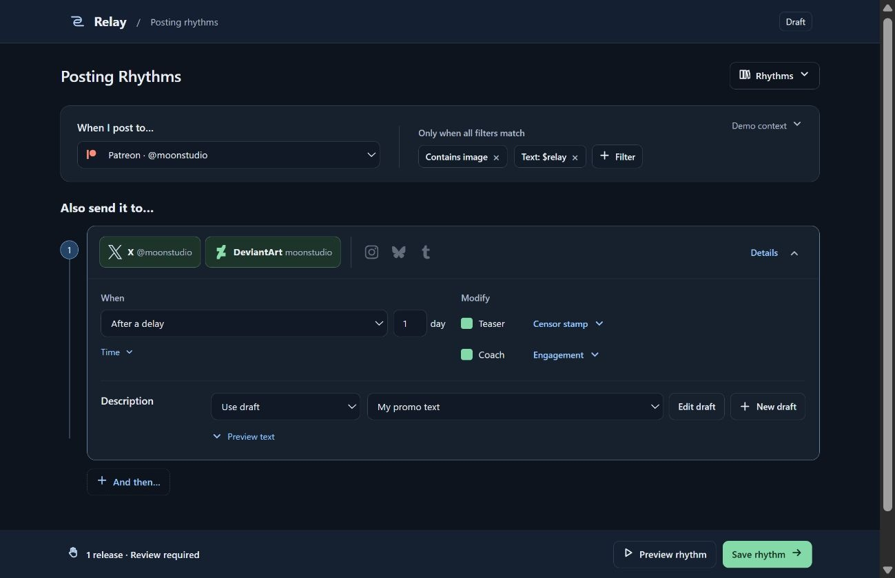

# Posting Rhythms — Studio sheet, revision 11

Posting Rhythms is now the stable workspace title. Preview rhythm sits beside Save rhythm and opens a native modal with a mock artwork, trigger conditions, destination logos, selected treatments and nested publication dependencies. The existing simulator is available under Sample execution inside the modal. Instagram, Bluesky and Tumblr appear as gray logos that open a connection invitation. Connect runs a local demo and Done closes it. Instagram is marked as planned support; no account access is requested and the mock cannot enter the destination configuration. Modify and Draft replace Changes and Snippet in the editor.

The frontend layout was approved on 2026-10-19. Validation: all 21 behavioral tests pass. Desktop 1321×854 and mobile 390×845 inspected; native Escape dismissal and focus return verified. The preview illustrates treatments and does not generate an export or publish.

## Earlier refinements

The preview-type menu now anchors beside its trigger on desktop, using the space to the right without adding a row. Narrow screens use a bounded anchored fallback. Escape/outside dismissal and unchanged row height verified; all 17 behavioral tests pass.

Earlier control refinement restores Only when all filters match and Coach’s Help me with goal picker. Destination tags are modestly larger, checkboxes use filled squares, and treatment labels sit closer to their toggles. Reusable prewritten description text is called a Snippet; persisted keys stay compatible. All 16 behavioral checks pass; desktop1321 and mobile390 inspected.

Earlier copy polish removes the subtitle, description instructions, repeated source/treatment notes and duplicate Test action. Time replaces the generic timing Options label; preview type is displayed on its own selector. Current checks: 15 tests passed and rendered at 1321px and 390px. Visual approval is left to the user.

Product naming: **Rhythm** is the user-facing name for the complete trigger, filters and release sequence. The editor consistently uses Rhythms, New rhythm, Test rhythm and Save rhythm. Existing filenames, storage keys and backend recipe identifiers stay compatible. Naming regression and existing behavior: 18 tests pass.

## Earlier inspection path — 2026-10-19

Reusable recipes for future posts are primary. **Recipes** opens an inline chooser above the complete source-and-release flow. Choose Art release rhythm (three releases), Share the original, New recipe, or the last recipe saved in this browser. Loading supports Undo and preserves the saved snapshot. The demo still uses one saved-recipe slot.

Patreon, X and DeviantArt logos identify the source and destination account tags. One Also send it to… heading leads directly to destinations; the tags remain editable when collapsed. Details sits to the right and opens timing, treatment and Description. Route-type headings and Editing badges are removed; collapsed timing/treatment summaries use generic description modes. Teaser/Coach checkboxes apply behavior; the selected preview name opens direct type choices, and Notes opens Coach notes. Description supports original/edit/saved context and versioned drafts.

The persistent Save recipe action opens final timezone, review, notification, name, Default and Always on choices. Saving never publishes. Confirm plan remains the separate one-time path. Working drafts recover under `relay-recipe-working-draft`, independently of saved configuration. Valid removal, Reset and template/recipe loading offer Undo. The simulator stacks into labeled mobile cards, and Test/review/handoff actions focus their revealed context.

Run `node --test docs/studio/posting-recipe-build-plans/demo/recipe-editor.test.mjs`: 15 behavioral checks cover presentation-only settings, release selection, receipt dependencies, source editing, saved-version isolation, deletion/Undo, draft recovery, calendar edges and review authority. Script syntax passed. Browser inspection covered 1440×900, the current user's 1321×854 viewport, 885×572 and mobile 390×845, including collapsed destinations and the recipe chooser. No production runtime, real publication or email is verified.

The selected Studio sheet direction, initial critique and independent finish review are recorded under `.impeccable/`. Root PRODUCT.md and DESIGN.md are scoped to this prototype. The earlier inspection instructions and verification below document revisions 2–6; their table arrangement and Continue flow have been superseded by the release accordions and save bar.

The independent full review accepted the chosen visual hierarchy. Its validation/focus fixes and the later Saved/Draft and accessibility corrections were scored resolved in the final review. The scoped Ponytail and current Web Design Guidelines review is recorded in `.impeccable/review/code-and-guideline-review.md`. The editor preview below shows revision 10; connect-preview.jpg shows the revision 11 connection invitation.; earlier verification remains historical. Physical notched-device behavior and production integrations were not run.

[Open the standalone HTML](recipe-editor.html). All CSS, JavaScript and icons are inline. No build, dependencies, login, network connection, model invocation, upload, publishing or email is required. The account identities and sample publications are fictional. The saved-recipe configuration uses browser storage under `relay-posting-recipe-demo-v2`; storage failure leaves editing available in the current tab.

Platform SVGs are inline: Patreon reuses `web/app/components/auth/auth-hub.tsx`; X and DeviantArt paths come from [Simple Icons](https://github.com/simple-icons/simple-icons/tree/develop/icons). No runtime icon request or dependency was added.

## Earlier inspection path — historical revision 6

Start blank to explore progressive disclosure, or choose **Load example** for a filtered three-route recipe.

1. Choose the Patreon account; open **Filter** and select Contains image, literal text/marker, or a link. Conditions are AND. The filter tray closes to removable chips.
2. Continue to reveal rows. Choose destinations, a delay or first/last day of this/next reference month, then optional Teaser/Coach. **Options** is a compact anchored dropdown for clock time and predecessor reference. It closes on outside click/Escape. No full-width timing tray remains.
3. Description has a dedicated rounded panel and Keep original / Edit original / Use saved description selector. **Demo artwork** switches between Not uploaded yet (Edit original disabled) and Moon garden uploaded (original previews/seeds editing). Saved descriptions support multiple prior drafts, preview, edit-as-new, creation and cancel; saved versions persist independently of recipe saving in `relay-recipe-description-drafts`. Edits preserve previous drafts/sibling rows. **And then…** creates a new row waiting for its predecessor's actual publication, with matching destinations; Options can change that reference.
4. Continue to the final tray: timezone, publishing authority, and notification preferences. R1 Review each post is available; remote approval, automatic and cancellation-window delivery are visibly later capabilities.
5. **Confirm plan** opens inline one-time target confirmation. **Save recipe** opens a separate inline name/Default/Always-on tray. Default and Always on are independent; neither grants publishing permission. Save persists configuration only; confirmed one-shot plans are simulated and not persisted as real jobs.
6. **Test** opens an inline matcher/execution panel. Try the unmarked-image and text-only samples. Link host and path-segment matching are exact; no URLs are fetched.
7. Review/hand off an action, then confirm its sample publication. Handoff alone leaves dependents waiting. X and DeviantArt's sample confirmation dates differ by two days, so their dependent routes get different dates. Pause the test, try an invalid URL or blocked handoff, and inspect the route summary previews.

Changes invalidate final acknowledgements and the old test snapshot. Editing final timezone retains its tray. Removing a route or destination that another route depends on shows an inline repair message; it does not silently rewrite the pipeline. The active editor uses no dialogs, browser alerts or pop-up wizard.

For local HTTP preview from the repository root:

```powershell
python -m http.server 8879 --bind 127.0.0.1 --directory docs/studio/posting-recipe-build-plans/demo
```

Open `http://127.0.0.1:8879/recipe-editor.html`. A local preview process was left available at the user's explicit request to inspect the page; it binds only loopback. The HTML itself is portable and self-contained. The browser automation tool permits HTTP(S), so direct-file opening is not automated.

## Design references and limits

The compact forms, neutral borders and contextual trays reference [GitHub Primer progressive disclosure](https://primer.style/product/ui-patterns/progressive-disclosure/), [forms](https://primer.style/product/ui-patterns/forms/) and [notification messaging](https://primer.style/product/ui-patterns/notification-messaging/). Relay retains its green primary action. Surfaces/controls are rounded; entrances use a short fade and respect reduced motion.

- Saved templates and Coach candidates are illustrative configuration/samples. There is no actual Previewizer render or LLM call.
- Trigger intake is represented by a single fictional connected Patreon account. X/DeviantArt are fictional bound target accounts. This does not assert the current backend already verifies these bindings.
- Original artwork is the input for every route; an earlier-route timing anchor is not image-edit chaining.
- Calendar calculations serve the demo. Production uses shared tested helpers, current capabilities, durable execution and strict receipt handling.
- Counts are indicative; production X validation must use platform-aware text/URL rules, not only string length.
- Simulation advances directly to actions' due dates; it is not a live clock or scheduler. No email preview is sent.
- At narrow widths, destination, timer and modification fields stack in that order; the execution simulator has its own labeled scroll region. No drag interaction is needed.

## Revision 2 verification — historical, 2026-10-18

- Standalone script syntax passed.
- **30 ad hoc DOM interaction checks passed** using installed happy-dom: progressive reveal; invalid source/filter/route validation; marker/media/link matching; third/fourth routes; protected dependencies; one-shot vs saved Default/Always-on; literal saved-copy escaping; handoff/receipt distinction; pause/recovery; independent dates; unsent summaries; no network execution or modal wizard.
- Browser inspected the blank trigger, inline filter tray, chips retained when routes appear, three-route example, and contextual Coach tray. Revised final controls are visible with unsupported modes disabled.
- Follow-up refinements keep timezone edits in the final tray, hide redundant Continue controls, and prevent testing unrevealed routes; targeted checks recorded with the final artifact.
- [Desktop screenshot](editor-preview.jpg) updated to the revised editor. Earlier revision-1 browser/mobile results are not presented as current revision-2 verification.
- No production runtime, real social editor, actual email delivery or linked database acceptance was executed for this design update. See [acceptance](../ACCEPTANCE.md) for future implementation gates.

## Revision 3 feedback verification — historical, 2026-10-18

- All five annotated concerns addressed: conversational “Also send it to…” heading, no step-name column/input, simple day timers, timing reference/optional clock moved into Options, and conversational description choices.
- **15 current regression checks passed**: unnamed save, opt-in clock selection, default 24-hour timer across DST, later dependency reference visibility, and publication-based progression among them. Script syntax passed.
- Browser verified the inspected 885px viewport: page width 870px, table width 804px inside an 828px region. The old horizontal scrollbar is no longer needed at this size. Browser error log was empty.
- Saved clock-based configurations remain compatible. New posts use `time: same` in this standalone demo; the production contract requires an explicit persisted timing-mode discriminator.
- Contract/build plan/acceptance updated to revision 3. No production backend changed.

## Revision 4 feedback verification — historical, 2026-10-18

- Destination-first columns: **To → When → Modifications**. Teaser / New description / Coach are selectable buttons, with inline stock/write-new description choice and independent Coach treatment.
- **19 ad hoc DOM checks passed**: correct order/defaults, validation, combined modifiers, tray retention, escaped custom text, stock/custom switching, destination-specific field retention, route/preset isolation, save/reload, legacy Coach migration, custom-base simulation, and receipt-only progression.
- Inline script syntax passed. Browser inspected all three modifiers together, wrote custom X/DeviantArt fields, switched to stock text, and closed trays. At 885px, the table remains 804px inside an 828px region; no horizontal overflow. Browser error log was empty.
- [Current screenshot](editor-preview.jpg) shows revision 4. Earlier revision verification above is historical. Product contract, codebase map, backlog and acceptance now match this revision. No production backend or real publishing was changed/tested.


## Revision 5 feedback verification — historical, 2026-10-18

- Options reveals the time input directly, with no checkbox or second disclosure. A blank time leaves elapsed-day mode unchanged; Clear restores it. The timing tray has no extra Done step.
- Description is a separate visible radio section: Keep original / Edit original / Use saved description. The relevant editor or stock picker appears directly. Original edits initialize once from the fictional sample and survive mode/destination changes; intentionally blank edits are not reseeded. Teaser and Coach remain independent.
- **20 current ad hoc DOM checks passed**, covering direct time selection/reset, source seeding/retention, saved picker, per-row isolation, save/reload, combined treatments, reviewed edited-base output, and receipt-only dependency progression. Inline script syntax passed.
- Browser inspected direct clock entry and Clear, original editing, saved-text selection, and the final layout. The screenshot below is revision 5. No production backend, real publication or email was changed/tested.


## Revision 6 feedback verification — historical, 2026-10-18

- Full-width timing has been replaced by a compact date selector and anchored Options dropdown. Date choices are delay or first/last day of the reference month/following month. Calendar targets before the reference require attention, independently of sibling actions; no silent rollover.
- Description occupies a dedicated panel with contextual original/edit/saved selection. Upcoming artwork disables Edit original. The separate saved-description library supports multiple drafts, preview, edit-as-new, creation and cancellation. And then initially waits for the prior post's publication receipt.
- **31 current ad hoc checks passed**: upcoming/uploaded edit gating, literal/retained edits, draft validation/persistence/version isolation/cancel/reload, chaining, all four month boundaries, explicit clocks, DST, leap/non-leap February, December rollover, invalid-date isolation and receipt-driven calendar dependencies. Script syntax passed.
- Happy-dom exposes an incorrect select.value for dynamically appended selected options; the affected assertion uses the rendered selected attribute plus preview. The real browser independently confirmed the new draft's selected value and retained library after refresh.
- Browser inspected the compact dropdown, Escape/outside dismissal, disabled original editing, new draft creation/selection/persistence, calendar selection, and the dedicated Description panel. Screenshot below is revision 6. No production backend, real posting or email was changed/tested.


