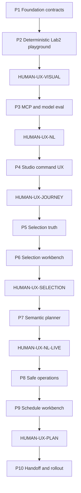

# Relay Command Layer + MCP — Master Plan

These briefs decompose the **Art Post Centralizer** Command Layer into four completed POC phases (P1–P4) and six conversational expansion phases (P5–P10). They are implementation contracts for a long-horizon Grok builder, not permission to reopen locked Library, Goal Cycle, Automations, Escape Hatch, or completed Studio renovation decisions.

**Product contract (P1–P4, frozen):** [`PRODUCT-CONTRACT.md`](PRODUCT-CONTRACT.md)  
**Conversation contract (P5–P10):** [`CONVERSATION-CONTRACT.md`](CONVERSATION-CONTRACT.md)  
**Dream-flow acceptance:** [`../../qa/RELAY_COMMAND_DREAM_FLOW_ACCEPTANCE.md`](../../qa/RELAY_COMMAND_DREAM_FLOW_ACCEPTANCE.md)  
**Lab 2 test ground:** [`LAB2-TEST-GROUND-CONTRACT.md`](LAB2-TEST-GROUND-CONTRACT.md)  
**Lab 3 test ground:** [`LAB3-TEST-GROUND-CONTRACT.md`](LAB3-TEST-GROUND-CONTRACT.md)  
**Builder preamble:** [`BUILDER-ORIENTATION.md`](BUILDER-ORIENTATION.md)  
**Traceability:** [`TRACEABILITY.md`](TRACEABILITY.md)  
**UI debt (fulfill):** [`UI-DEBT.md`](UI-DEBT.md)  
**Expansion go/no-go:** [`EXPANSION-GONOGO.md`](EXPANSION-GONOGO.md)

## Mission

Give a creator a typed, auditable way to **speak organization and schedules into existence** against a real Relay Library, then see the Studio **physically rearrange**. Construction is capability-first. Humans stop only at named UX playgrounds, migrations that touch hosted databases, security acceptance, flags, and credentials.

## Control plane — Git-only exception

This program does **not** use the Airtable Production Ledger as execution truth. Status, claimed work, Delta Out, and evidence live in Git beside the code:

| Artifact | Role |
|---|---|
| This README status table | What is Queued / In progress / Blocked / Done |
| Phase slice files | Work items, batches, verification |
| Slice Delta Out sections | Session handoff |
| [`UI-DEBT.md`](UI-DEBT.md) | Playground chrome to fulfill (calendar grid, Collections density); not capability bugs |
| `docs/qa/RELAY_COMMAND_*_EVIDENCE.md` (future, at gates) | Milestone evidence |

**Rationale:** one Grok builder, serialized phases, versioned contracts. Mirroring every todo into Airtable would create a second truth. An optional later portfolio-level ledger row is a human choice, not a builder task.

Do not invent Airtable rows, Session Locks, or v0 loops for this program. Other Rescue programs keep their existing control planes.

## Program status

| Phase | Name | Depends on | Human UX gate | Status |
|---|---|---|---|---|
| P1 | Content foundation and capability contracts | — | None (migrate/security only if schema ships) | Done |
| P2 | Deterministic Lab 2 playground | P1 | **HUMAN-UX-VISUAL** — physical gallery/schedule organization | Done |
| P3 | MCP adapter and model evaluation | P2 visual gate | **HUMAN-UX-NL** — type → clarify → see Studio move | Done |
| P4 | Studio command UX and lens refinement | P3 NL gate | **HUMAN-UX-JOURNEY** — five-minute creator path + expansion go/no-go | Done |
| P5 | Deterministic full-corpus selection truth | P4 Done | Completeness tests; optional live grid/command ID parity | Done |
| P6 | Selection confirmation workbench | P5 Done | **HUMAN-UX-SELECTION** | Done |
| P7 | Semantic planner (selection-only) | P6 + HUMAN-UX-SELECTION | **HUMAN-UX-NL-LIVE** — non-exact phrases | Done |
| P8 | Safe operations + durable ChangeSets | P7 + HUMAN-UX-NL-LIVE | **HUMAN-MIGRATE** for durable store | Done |
| P9 | Finite schedule workbench | P8 Done | **HUMAN-UX-PLAN** | In progress |
| P10 | Handoff conveyor + staged rollout | P9 + HUMAN-UX-PLAN | Extension journey, then shared-host **HUMAN-FLAG** | Blocked on P9 |

Status changes require a Delta Out proving the phase exit gate. “Code written” is not “Done.”

P1–P8 are **Done**. Do not reopen them. **HUMAN-UX-NL-LIVE** signed Pass 2026-08-30. Hosted Command persist tables applied 2026-08-30 (HUMAN-MIGRATE). P9 T01–T04 landed (compiler, ProposalPatch, Lab 3 calendar squash, final plan apply). Next is **RC-P9-T05 HUMAN-UX-PLAN** only. Do not start P10. Production CommandBox stays unmounted.

## Locked decisions

- User supplies semantics; Relay executes mechanics. No unsolicited curation or similarity clustering.
- Five POC capabilities plus Undo: find/resolve, collections, correct-layer revise, release plan/schedule, destination drafts, undo.
- No autonomous publish. Destination drafts and rail slices are not published posts.
- Typed capability facade — never Prisma-generated MCP, never wrap all of `src/server.ts`.
- ChangeSets with resolved ID snapshots, idempotency, expected revision, audit, and undo.
- Imported edits → presentation/overrides. Native edits → append `PostVersion`.
- Analytics to the model as prepared fact packs. Weak evidence disclosed.
- Studio Lab 2 (`/studio/lab2`) is the required human playground, backed by a ~100–120 post **Postgres** corpus, not static thumbs in `web/app/components/studio-lab2/fixtures.ts`.
- Chronological, Collections, and Posting Schedule lenses are **capacity** in the foundation; final chrome and persistence wait for playground findings.
- In-product command box is the paid UX. External MCP is an optional peer on the same facade.
- Scoped `mcp` (or equivalent) grants; do not reuse unconstrained web/extension sessions.
- Feature flags default off. Corpus seed requires `RELAY_ALLOW_STUDIO_LAB2_SEED=1` and must refuse production.
- Cursor Grok 4.6 X-High is the sole approved implementation builder for this program.
- P5–P10: hosted LLM is an untrusted planner; deterministic TypeScript remains authority. Lab 3 is the conversational playground; Lab 2 stays the fixture/eval corpus. See [`CONVERSATION-CONTRACT.md`](CONVERSATION-CONTRACT.md).

## Dependency graph



P1–P4 are historical. P5 may proceed through automated batches until a hosted migration is required. P6 must not start until P5 snapshots match the visible Lab 3/Lab 2 grids. P7 must not start until **HUMAN-UX-SELECTION**. P8 must not start until **HUMAN-UX-NL-LIVE**. P9 must not start until P8 durable apply/undo exists. P10 must not start until **HUMAN-UX-PLAN**.

## Phase index

1. [`01-PHASE-1-CONTENT-FOUNDATION.md`](01-PHASE-1-CONTENT-FOUNDATION.md) — Done
2. [`02-PHASE-2-DETERMINISTIC-PLAYGROUND.md`](02-PHASE-2-DETERMINISTIC-PLAYGROUND.md) — Done
3. [`03-PHASE-3-MCP-MODEL-EVALUATION.md`](03-PHASE-3-MCP-MODEL-EVALUATION.md) — Done
4. [`04-PHASE-4-STUDIO-COMMAND-UX.md`](04-PHASE-4-STUDIO-COMMAND-UX.md) — Done
5. [`05-PHASE-5-SELECTION-TRUTH.md`](05-PHASE-5-SELECTION-TRUTH.md) — Done
6. [`06-PHASE-6-SELECTION-WORKBENCH.md`](06-PHASE-6-SELECTION-WORKBENCH.md) — Done
7. [`07-PHASE-7-SEMANTIC-PLANNER.md`](07-PHASE-7-SEMANTIC-PLANNER.md) — **Done** (HUMAN-UX-NL-LIVE Pass 2026-08-30)
8. [`08-PHASE-8-SAFE-OPERATIONS.md`](08-PHASE-8-SAFE-OPERATIONS.md) — **Done**
9. [`09-PHASE-9-SCHEDULE-WORKBENCH.md`](09-PHASE-9-SCHEDULE-WORKBENCH.md) — **Queued** (next RC-P9-T01 + RC-P9-T02)
10. [`10-PHASE-10-HANDOFF-AND-ROLLOUT.md`](10-PHASE-10-HANDOFF-AND-ROLLOUT.md)

## Long-horizon run rules

1. Read [`BUILDER-ORIENTATION.md`](BUILDER-ORIENTATION.md), this status table, the claimed phase, and the latest Delta Out before editing.
2. Claim at most two numbered todos per session unless the phase marks a larger sealed batch. Keep behavior and focused tests together.
3. Continue through unblocked automated work. Stop only at named human gates or evidenced product-contract contradictions.
4. Do not commit, push, migrate a hosted database, flip production flags, or choose model vendors without authorization.
5. Treat the hot-file table as serialized.
6. Finish every batch with Delta Out. Name exactly one next unblocked todo set.

## Safe parallel work

- After P1 freezes TypeScript contracts, fixture JSON authoring for the Lab 2 corpus may start in the same phase’s later todos, but seed **apply** waits for the capability types it asserts.
- Web Lab 2 lens chrome in P2 may use fixture-backed component tests in parallel with seed scripts, but live `/studio/lab2` acceptance requires the seeded creator.
- Eval corpus YAML/JSON in P3 may be drafted after the Lab 2 `eval` block exists; live model trials wait for MCP + HUMAN-UX-VISUAL.
- Do not parallelize P3 UI harness work with P4 production chrome. P4 is a strangler after the harness is proven.
- Do not parallelize P5 loader/contracts with P6 modal chrome. P6 consumes a frozen snapshot shape.
- Do not parallelize P7 planner with P8 durable apply. Planner is selection-only until P8.
- Do not restyle production `GalleryView.tsx` CommandBox mount until P10 + HUMAN-FLAG. Lab 3 floorspace edits are allowed in P5–P9 when the claimed todo owns them.

## Hot-file ownership

| File/domain | Primary owner | Merge note |
|---|---|---|
| `src/studio/command/` contracts, ChangeSet, facade | P1 freeze → P2–P4 implement → P5 extend selection | P5 may extend `CommandSelectionQuery` / `ResolvedSelection` only |
| `src/studio/command/library-items-from-db.ts` | P5 | Unify with gallery effective metadata |
| `src/studio/eval/command-harness-interpret.ts` | P3 fixture path; P5 Lab 3 branch; P7 planner branch | Keep fixture lookup as CI fallback |
| `src/ai/` | P7 | Structured output / tool-call types; do not change Goal Cycle prompts except as a read reference |
| `prisma/schema.prisma` and Command Layer migrations | P1–P3 historical → P8 durable proposal/ChangeSet/undo | Serialize. Hosted apply is **HUMAN-MIGRATE** |
| `src/server.ts` | P1–P4 historical → P5–P10 command HTTP | One worker at a time; extract routers rather than growing the monolith blindly |
| `src/middleware/idempotency-store.ts` and store wiring | P1 | Shared Redis/Postgres store before apply |
| `src/identity/` session kinds and consent | P1 types → P3 issuance | Do not overload extension grants |
| `web/lib/relay-api.ts` | P2–P4 → P5–P10 append frozen methods only | |
| `web/app/studio/GalleryView.tsx` | Lab 3 floorspace P5–P9; production CommandBox P10 only | Do not mount production CommandBox until HUMAN-FLAG |
| `web/app/components/studio/command/*` | P4 → P6–P9 | Selection review / plan shaping chrome |
| `web/app/components/studio-lab3/*` | P6 / P9 | Calendar squash, overlays |
| `web/app/components/studio-lab2/*` | P2–P4 | Preserve Lab 2 golden path |
| `web/app/studio/lab2/*` | P2–P4 | Required fixture playground |
| `web/app/studio/lab3/*` | P5–P9 | Conversational playground |
| Gallery collection APIs | P2 / P8 apply via existing services | Reuse; do not fork a second collection store |
| Schedule rail / distribution / extension | P2 drafts → P9 finite plan → P10 existing handoff | Draft/plan only; no publish |
| Goal Cycle / Automations / Escape Hatch | Do not touch | Separate programs |
| `.docs/anthropic/` | Do not reconstruct | Missing tree is out of scope |

## Human stop conditions

| Gate | When | Builder behavior |
|---|---|---|
| **HUMAN-MIGRATE** | Prisma migrate / destructive backfill on staging or production | Write SQL + rollback notes; do not apply hosted |
| **HUMAN-SECURITY** | RLS gap lockdown, new session kind, MCP token design sign-off | Evidence + questions; no silent “fail open” |
| **HUMAN-FLAG** | Enable Command Layer / apply / MCP / Studio UX in a shared environment | Leave flags off |
| **HUMAN-CREDENTIALS** | Model vendor keys, OAuth client for MCP consent | Do not invent secrets |
| **HUMAN-UX-VISUAL** | End of P2 | Seed Lab 2, restart stack, hand script from Lab 2 contract |
| **HUMAN-UX-NL** | End of P3 | Leave command harness running with reset recipe |
| **HUMAN-UX-JOURNEY** | End of P4 | Five-minute path + expansion go/no-go |
| **HUMAN-UX-SELECTION** | End of P6 | Lab 3 tile review: exclude, already-posted warning, Approve freezes IDs |
| **HUMAN-UX-NL-LIVE** | End of P7 | Non-exact sentences select the right Lab 3/Lab 2 set; fixture path still works |
| **HUMAN-UX-PLAN** | End of P9 | Hero Academy-style walk: confirm pieces → cadence edit → drag tweak → confirm schedule |

Not human gates: local unit/integration tests, fixture validation, `npm run typecheck`, local seed against a developer database with the allow flag, component tests, stack restart after a local behavior change.

## Program complete (P1–P4)

P1–P4 are **Done** when RC-DF-01 through RC-DF-17 have owners and evidence, Lab 2 reset/replay works, deterministic organization is visible, the fixture NL harness has a recorded human pass, production command UX is flag-gated, tenant isolation holds, no gated media leaked, undo works, and an expansion go/no-go is written. That bar was met 2026-08-29. Autonomous publish remaining off is success, not a gap.

## Expansion complete (P5–P10)

Complete only when Lab 3 reads and selects the same corpus it displays, the selection workbench and live-NL gates are signed, durable ChangeSets/Undo survive restart, a finite weekly-drop plan can be shaped and approved without publishing, due drops use the existing extension handoff, and production Studio mount remains flag-gated until HUMAN-FLAG.

## Planning-pack Delta Out

```text
Relay Command Delta Out
- Slice / claimed todos: docs-only planning pack
- Completed: program hub, product contract, builder orientation, traceability, Lab 2 contract, RC-DF acceptance, four phase plans, canonical pointers
- Files created/edited: docs/studio/relay-command-mcp-build-plans/*, docs/qa/RELAY_COMMAND_DREAM_FLOW_ACCEPTANCE.md, AGENTS.md, road map.md, PLAN_STUDIO_RENOVATION_MASTER.md, pattern-library.md, UX_ACCEPTANCE_GUARDRAILS.md
- Migration and backfill state: none
- Contracts changed: new program freeze only; Goal Cycle / Automations / Escape Hatch untouched
- Commands and results: documentation authoring
- Manual/browser checks: n/a (docs-only)
- Feature flags / kill switches: specified, not implemented
- Known risks or human gates: first implementation gate is P1; first UX gate is HUMAN-UX-VISUAL after P2
- Next unblocked todo IDs: RC-P1-T01 + RC-P1-T02
```

```text
Relay Command Delta Out
- Slice / claimed todos: RC-P1-T01 through RC-P1-T08 (P1 exit)
- Completed: Phase 1 content foundation — contracts, selection, sequence, write router, ChangeSet preview stub, idempotency wrapper, creator context, flags default off
- Files created/edited: src/studio/command/*, tests/studio/command/*, .env.example, 01-PHASE-1-CONTENT-FOUNDATION.md Delta Outs
- Migration and backfill state: none
- Contracts changed: relay-command-wire-v1 frozen
- Commands and results: focused vitest 45 passed; command files typecheck clean
- Manual/browser checks: n/a
- Feature flags / kill switches: all off
- Known risks or human gates: P1 Done. Next is P2 Lab 2 corpus JSON (RC-P2-T01). Stopped here per exit gate.
- Next unblocked todo IDs: RC-P2-T01
```

```text
Relay Command Delta Out
- Slice / claimed todos: RC-P2-T01 through RC-P2-T09 (P2 code complete; UX gate open)
- Completed: deterministic Lab 2 playground — corpus, seed/eval, ChangeSet apply/undo, lenses, flag-gated command HTTP. Stopped for HUMAN-UX-VISUAL.
- Files created/edited: see 02-PHASE-2-DETERMINISTIC-PLAYGROUND.md latest Delta Out
- Migration and backfill state: none
- Contracts changed: none
- Commands and results: focused P2 vitest 17 passed; corpus fixture_hash 7e36b9b4fec4d2e84d12ddad79ce083002747cd0e3cb35aaae4ae0121dffa61a
- Manual/browser checks: awaiting human Script A at http://localhost:3000/studio/lab2
- Feature flags / kill switches: committed defaults still off
- Known risks or human gates: HUMAN-UX-VISUAL. P2 is In progress, not Done. Do not start P3.
- Next unblocked todo IDs: none until visual pass; then RC-P3-T01
```

```text
Relay Command Delta Out
- Slice / claimed todos: HUMAN-UX-VISUAL (P2 exit)
- Completed: Human accepted Studio Lab 2 as the Command Layer playground. P2 → Done. P3 unblocked at RC-P3-T01.
- Files created/edited: docs/qa/RELAY_COMMAND_P2_VISUAL_EVIDENCE.md (verdict Pass 2026-08-28); this status table
- Migration and backfill state: none
- Contracts changed: none
- Commands and results: n/a (gate)
- Manual/browser checks: Lab 2 live at http://localhost:3000/studio/lab2; chronological grid, lenses, rail, Load more observed; Goals icon-only launcher left of Active Posts
- Feature flags / kill switches: committed defaults still off
- Known risks or human gates: P2 Done. Next is P3 Batch 1 (RC-P3-T01 + RC-P3-T03). Do not start P4.
- Next unblocked todo IDs: RC-P3-T01 + RC-P3-T03
```

```text
Relay Command Delta Out
- Slice / claimed todos: RC-P3-T01 + RC-P3-T03 (P3 Batch 1)
- Completed: MCP adapter + compact/safe I/O. See 03-PHASE-3-MCP-MODEL-EVALUATION.md latest Delta Out.
- Files created/edited: src/studio/command/mcp/*, tests/studio/command/mcp-tools.test.ts, tests/fixtures/relay-command-mcp-tool-schemas.json, src/server.ts, .env.example
- Migration and backfill state: none
- Contracts changed: none
- Commands and results: mcp-tools.test.ts 17 passed
- Manual/browser checks: n/a
- Feature flags / kill switches: MCP still default off
- Known risks or human gates: P3 In progress. Next RC-P3-T02 (scoped grants and audit). HUMAN-UX-NL remains at T07.
- Next unblocked todo IDs: RC-P3-T02
```

```text
Relay Command Delta Out
- Slice / claimed todos: RC-P3-T02 (P3 Batch 2)
- Completed: Scoped MCP grants + hashed-input audit. See 03-PHASE-3-MCP-MODEL-EVALUATION.md latest Delta Out.
- Files created/edited: prisma CommandGrant/CommandAuditEvent + migration; src/studio/command/mcp grant/audit/auth/HTTP; tests/studio/command/mcp-grants.test.ts
- Migration and backfill state: SQL written, hosted not applied (HUMAN-MIGRATE / HUMAN-SECURITY)
- Contracts changed: none (no SessionKind.mcp)
- Commands and results: mcp-tools + mcp-grants 26 passed; tsconfig.build --noEmit clean
- Manual/browser checks: flag-off 404s after stack restart
- Feature flags / kill switches: MCP still default off
- Known risks or human gates: P3 In progress. Next RC-P3-T04 (eval corpus). HUMAN-UX-NL remains at T07. Do not start P4.
- Next unblocked todo IDs: RC-P3-T04
```

```text
Relay Command Delta Out
- Slice / claimed todos: RC-P3-T04 (P3 Batch 3)
- Completed: Eval corpus + facade-only runner. See 03-PHASE-3-MCP-MODEL-EVALUATION.md latest Delta Out.
- Files created/edited: tests/fixtures/relay-command-eval/corpus.json; src/studio/eval/*; scripts/eval-relay-command.mjs; tests/studio/eval/command-eval-facade.test.ts; package.json
- Migration and backfill state: none
- Contracts changed: none
- Commands and results: command-eval-facade.test.ts 10 passed; eval:relay-command --facade-only exit 0 on seeded Lab 2 (fixture_hash 7e36b9b4fec4d2e84d12ddad79ce083002747cd0e3cb35aaae4ae0121dffa61a)
- Manual/browser checks: n/a
- Feature flags / kill switches: MCP still default off
- Known risks or human gates: P3 In progress. Next RC-P3-T06 (Lab 2 command harness). HUMAN-UX-NL remains at T07. Do not start P4. T05 optional live model does not block T06.
- Next unblocked todo IDs: RC-P3-T06
```

```text
Relay Command Delta Out
- Slice / claimed todos: RC-P3-T06 (P3 Batch 4)
- Completed: Lab 2 command harness UX. See 03-PHASE-3-MCP-MODEL-EVALUATION.md latest Delta Out.
- Files created/edited: Lab2CommandHarness.tsx; chassis mount; POST /api/v1/creator/command/harness/interpret; harness interpret over T04 fixture
- Migration and backfill state: none
- Contracts changed: none
- Commands and results: lab2-command-harness + interpret + chassis + facade eval 28 passed
- Manual/browser checks: 2026-08-28 Lab 2: labelled command box above lens switcher; Preview of Academy command → error "Command layer is disabled" (flags off); shelf + feed window ≥4 rows. See 03 Delta Out.
- Feature flags / kill switches: layer/apply/MCP still default off
- Known risks or human gates: P3 In progress. Next RC-P3-T07 (HUMAN-UX-NL). T05 optional. Do not start P4.
- Next unblocked todo IDs: RC-P3-T07
```

```text
Relay Command Delta Out
- Slice / claimed todos: RC-P3-T07 (HUMAN-UX-NL sign-off)
- Completed: Human signed Script B pass (AskQuestion: pass-start-p4). P3 → Done. T05 live model stays skipped until after P4.
- Files created/edited: docs/qa/RELAY_COMMAND_P3_NL_EVIDENCE.md; this status table
- Migration and backfill state: none
- Contracts changed: none
- Commands and results: n/a (gate)
- Manual/browser checks: Script B in evidence file
- Feature flags / kill switches: committed defaults still off
- Known risks or human gates: P3 Done. Next RC-P4-T01. Do not start T05.
- Next unblocked todo IDs: RC-P4-T01
```

```text
Relay Command Delta Out
- Slice / claimed todos: RC-P4-T01 (P4 Batch 1)
- Completed: Shared CommandBox + risk/retry/stale/empty states; Lab 2 wrapper. Enter Previews only. Focus stays in the command field after Apply. See 04-PHASE-4-STUDIO-COMMAND-UX.md.
- Files created/edited: web/app/components/studio/command/*; web/lib/command-risk.ts; Lab2CommandHarness.tsx; tests/web/command-box.test.tsx; tests/web/command-journey.test.tsx
- Migration and backfill state: none
- Contracts changed: none. GalleryView untouched.
- Commands and results: focused web vitest 26 passed; tsconfig.build --noEmit clean
- Manual/browser checks: 2026-08-28 Lab 2 after restart: labelled box, Reset, Enter Previews only, Apply click-only, Academy clarification. See 04 Delta Out.
- Feature flags / kill switches: committed defaults still off
- Known risks or human gates: P4 In progress. Next RC-P4-T02 + RC-P4-T03. Do not start T04 journey or T05.
- Next unblocked todo IDs: RC-P4-T02 + RC-P4-T03
```

```text
Relay Command Delta Out
- Slice / claimed todos: RC-P4-T02 + RC-P4-T03 (P4 Batch 2)
- Completed: Dense Collections board; Schedule month grid with prev/next; last-lens localStorage; flags GET + disabled CommandBox when layer off. See 04-PHASE-4-STUDIO-COMMAND-UX.md.
- Files created/edited: see 04 Delta Out
- Migration and backfill state: none
- Contracts changed: none. GalleryView untouched.
- Commands and results: focused web/command vitest 49 passed; tsconfig.build --noEmit clean
- Manual/browser checks: Lab 2 Collections dense board; Schedule August→September; last-lens restore; flags GET; command layer on after login
- Feature flags / kill switches: committed defaults still off
- Known risks or human gates: P4 In progress. Next RC-P4-T04. Do not start T05 or production GalleryView mount.
- Next unblocked todo IDs: RC-P4-T04
```

```text
Relay Command Delta Out
- Slice / claimed todos: RC-P4-T04 (P4 Batch 3)
- Completed: Five-minute journey wiring + builder dry-run. Stop for HUMAN-UX-JOURNEY. See 04-PHASE-4-STUDIO-COMMAND-UX.md and docs/qa/RELAY_COMMAND_P4_JOURNEY_EVIDENCE.md.
- Files created/edited: see 04 Delta Out
- Migration and backfill state: none
- Contracts changed: none. GalleryView untouched.
- Commands and results: focused vitest 38 passed; tsconfig.build --noEmit clean
- Manual/browser checks: Script C builder dry-run 2026-08-28 (desktop + 390px)
- Feature flags / kill switches: committed defaults still off
- Known risks or human gates: HUMAN-UX-JOURNEY required. Do not start T05 or production GalleryView mount.
- Next unblocked todo IDs: HUMAN-UX-JOURNEY then RC-P4-T05
```

```text
Relay Command Delta Out
- Slice / claimed todos: HUMAN-UX-JOURNEY + RC-P4-T05
- Completed: Human signed Script C pass (AskQuestion: pass). Command chrome fitted in the gallery column (Reset/Apply no longer under the fixed rail). Expansion go/no-go written. P4 → Done. Program complete.
- Files created/edited: docs/qa/RELAY_COMMAND_P4_JOURNEY_EVIDENCE.md (signed); EXPANSION-GONOGO.md; StudioLab2Chassis.tsx + CommandBox.tsx (gallery-column command chrome); this status table
- Migration and backfill state: none
- Contracts changed: none. GalleryView still unmounted. Autonomous publish never.
- Commands and results: studio-lab2-chassis + command-box vitest 20 passed after fit fix
- Manual/browser checks: 2026-08-29 Lab 2 — Preview/Apply/Reset left of rail; elementFromPoint hits the buttons. Human Script C passed (keyboard during overlap; visual fitted after).
- Feature flags / kill switches: committed defaults still off
- Known risks or human gates: Production mount, DB presets, profile commands, automations composition, live-model eval all **defer**. HUMAN-FLAG before Studio UX on a shared host.
- Next unblocked todo IDs: none in this program (deferred items are later slices)
```

```text
Relay Command Delta Out
- Slice / claimed todos: docs-only P5–P10 conversational expansion pack
- Completed: conversation contract; Lab 3 test-ground note; six executable phase files (P5–P10); hub amendments to 00-README, TRACEABILITY, BUILDER-ORIENTATION, EXPANSION-GONOGO (2026-08-30), PRODUCT-CONTRACT pointer, AGENTS.md program row. P1–P4 remain Done. No product code.
- Files created/edited: docs/studio/relay-command-mcp-build-plans/CONVERSATION-CONTRACT.md; LAB3-TEST-GROUND-CONTRACT.md; 05-PHASE-5-SELECTION-TRUTH.md through 10-PHASE-10-HANDOFF-AND-ROLLOUT.md; 00-README.md; EXPANSION-GONOGO.md; TRACEABILITY.md; BUILDER-ORIENTATION.md; PRODUCT-CONTRACT.md; AGENTS.md; road map.md; docs/qa/UX_ACCEPTANCE_GUARDRAILS.md; docs/pattern-library.md
- Migration and backfill state: none
- Contracts changed: new P5–P10 freeze in CONVERSATION-CONTRACT.md; P1–P4 PRODUCT-CONTRACT.md unchanged except pointer. Goal Cycle / Automations / Escape Hatch untouched.
- Commands and results: documentation authoring
- Manual/browser checks: n/a (docs-only; no stack restart)
- Feature flags / kill switches: expansion flag names specified, not implemented; committed defaults still off
- Known risks or human gates: first implementation is P5. Do not start P6 until P5 exit. HUMAN-UX-SELECTION / NL-LIVE / PLAN / FLAG remain later. Live-model T05 superseded by P7.
- Next unblocked todo IDs: RC-P5-T01 + RC-P5-T02
```

```text
Relay Command Delta Out
- Slice / claimed todos: RC-P5-T01 + RC-P5-T02
- Completed: Lab 3 interpret/apply data plane + Gallery-effective command loader. P5 → In progress. P6 still blocked.
- Files created/edited: see 05-PHASE-5-SELECTION-TRUTH.md latest Delta Out
- Migration and backfill state: none
- Contracts changed: none
- Commands and results: see 05 Delta Out
- Manual/browser checks: stack restart after interpret HTTP branch
- Feature flags / kill switches: committed defaults still off
- Known risks or human gates: P5 exit still requires T03–T06. Do not start P6.
- Next unblocked todo IDs: RC-P5-T03 + RC-P5-T04
```

```text
Relay Command Delta Out
- Slice / claimed todos: RC-P5-T03 + RC-P5-T04
- Completed: Bounded boolean selection AST (`all`/`any`/`not`, depth 2 / 8 leaves) plus missing predicates. `search_library` returns a complete snapshot (`complete=true`, checksum, evidence, warnings) or fails closed on a truncated catalog. P5 remains In progress (T05–T06 open).
- Files created/edited: src/studio/command/contracts.ts; src/studio/command/selection.ts; src/studio/command/selection-snapshot.ts; src/studio/command/library-items-from-db.ts; src/studio/command/capability-facade.ts; src/studio/command/mcp/tool-defs.ts; src/studio/command/mcp/dispatch.ts; src/studio/command/mcp/http-routes.ts; src/studio/eval/command-eval-runner.ts; src/studio/eval/command-harness-interpret-creator.ts; tests/studio/command/selection.test.ts; tests/studio/command/selection-snapshot.test.ts; tests/studio/command/contracts.test.ts; tests/studio/command/library-items-from-db-parity.test.ts; tests/fixtures/relay-command-mcp-tool-schemas.json; LAB3-TEST-GROUND-CONTRACT.md; TRACEABILITY.md; this file
- Migration and backfill state: none
- Contracts changed: `CommandSelectionQuery` groups + new leaves (`description_contains`, `tier_ids`, `media_type`, `publish_state`, `creative_work_id`, `text_only_posts`, `numbered_sequence`); `ResolvedSelection` is a complete snapshot. Unknown keys rejected. MCP `search_library` schema matches. Production `/studio` CommandBox still unmounted.
- Commands and results: vitest selection, selection-snapshot, library-items-from-db-parity, contracts, command-harness-interpret, command-harness-interpret-creator, mcp-tools, mcp-grants green; JSON `--facade-only` scenarios green; `npx tsc -p tsconfig.build.json --noEmit` exit 0. Seeded-DB facade eval still blocked on leftover Lab 2 playground collection_count=2 — pre-existing, not this batch.
- Manual/browser checks: stack restart after MCP search_library snapshot + draft-load branch (8787/3000).
- Feature flags / kill switches: committed Command Layer defaults still off
- Known risks or human gates: T05 must measure completeness/perf before any GIN/trigram. Do not start P6. Next batch is probe + wrap-up tests.
- Next unblocked todo IDs: RC-P5-T05 + RC-P5-T06
```

```text
Relay Command Delta Out
- Slice / claimed todos: RC-P5-T05 + RC-P5-T06
- Completed: Completeness/perf probe recorded Lab 2 JSON+DB and Dev Ava DB catalogs complete and within search p95 budget; **no index**. Seeded `--facade-only` `db.status=ok` after Lab 2 playground restore. P5 → **Done**. P6 unblocked (Batch 1 claimed in the same session after this gate).
- Files created/edited: see 05-PHASE-5-SELECTION-TRUTH.md latest Delta Out
- Migration and backfill state: none; index_recommendation=no_index
- Contracts changed: none
- Commands and results: see 05 Delta Out (vitest 40/40; tsc 0; probe ok; eval ok + db.status=ok)
- Manual/browser checks: none this batch (CLI only; no stack restart)
- Feature flags / kill switches: committed defaults still off
- Known risks or human gates: Do not start P7. Eval restore wipes leftover Lab 2 playground command collections. HUMAN-UX-SELECTION is the P6 gate.
- Next unblocked todo IDs: RC-P6-T01 + RC-P6-T02
```

```text
Relay Command Delta Out
- Slice / claimed todos: RC-P6-T01 + RC-P6-T02
- Completed: In-memory selection proposal + Lab 3 tile review overlay. P6 → In progress. Exclude/Approve still T03; HUMAN-UX-SELECTION still T04.
- Files created/edited: see 06-PHASE-6-SELECTION-WORKBENCH.md latest Delta Out
- Migration and backfill state: none (in-memory store; P8 persists)
- Contracts changed: `RELAY_COMMAND_SELECTION_UX_ENABLED` reader; committed example stays false
- Commands and results: see 06 Delta Out (vitest green; tsc 0; facade-only db.status=ok)
- Manual/browser checks: Lab 3 Hero Academy preview opens Review selection overlay; Escape closes; gallery unchanged
- Feature flags / kill switches: committed defaults still off; local Lab 3 may enable selection UX
- Known risks or human gates: Do not start P7. Next batch is exclude/freeze + evidence template.
- Next unblocked todo IDs: RC-P6-T03 + RC-P6-T04
```

```text
Relay Command Delta Out
- Slice / claimed todos: RC-P6-T03 + RC-P6-T04
- Completed: Exclude / restore / select-all/none within the proposal; Approve freezes IDs + checksum (idempotent). Lab 3 Apply-to-library stays off until P8. Evidence template prepared. P6 remains In progress until HUMAN-UX-SELECTION.
- Files created/edited: src/studio/command/proposal-types.ts; src/studio/command/http-routes.ts; web/lib/relay-api.ts; web/lib/command-selection-review.ts; web/app/components/studio/command/SelectionReviewOverlay.tsx; web/app/components/studio/command/CommandBox.tsx; tests/studio/command/proposal-types.test.ts; tests/web/selection-review.test.tsx; docs/qa/RELAY_COMMAND_P6_SELECTION_EVIDENCE.md; TRACEABILITY.md; LAB3-TEST-GROUND-CONTRACT.md; BUILDER-ORIENTATION.md; EXPANSION-GONOGO.md; 00-README.md; this file
- Migration and backfill state: none. Proposal store is process memory; P8 persists.
- Contracts changed: POST `/api/v1/creator/command/selection-proposal/patch` (`exclude` / `restore` / `select_all` / `select_none` / `approve`). `assertNoFrozenExpansion` for P7. Production CommandBox still unmounted. Apply ChangeSet unused.
- Commands and results: vitest proposal-types, contracts, selection-review, command-box, command-journey, lab2-command-harness, command-eval-facade — passed. `npx tsc -p tsconfig.build.json --noEmit` exit 0. `npm run eval:relay-command -- --facade-only` ok=true, db.status=ok.
- Manual/browser checks: stack restart (8787/3000). Lab 2 login → `/studio/lab3`. Preview Hero Academy → Review selection (20). Exclude Page 8 → 19 items + 1 excluded. Approve → Selection approved, 19 frozen, Apply hidden. Escape keeps freeze. Shelf still Photo Studies only (no Hero Academy collection).
- Feature flags / kill switches: committed `.env.example` still has selection UX **false**. Local Lab 3 may enable it.
- Known risks or human gates: **HUMAN-UX-SELECTION** required. Do not start P7. In-memory store dies on API restart. Native thumbs still 404 until HUMAN-MIGRATE derivatives.
- Next unblocked todo IDs: HUMAN-UX-SELECTION, then RC-P7-T01 + RC-P7-T02
```

```text
Relay Command Delta Out
- Slice / claimed todos: HUMAN-UX-SELECTION
- Completed: Human signed Pass 2026-08-30. P6 → **Done**. P7 unblocked (Batch 1 claimed same session).
- Files created/edited: see 06-PHASE-6-SELECTION-WORKBENCH.md latest Delta Out
- Migration and backfill state: none
- Contracts changed: none
- Commands and results: n/a (gate)
- Manual/browser checks: human Lab 3 freeze walk
- Feature flags / kill switches: committed defaults still off
- Known risks or human gates: Next is planner types + CommandSemanticPlanner only. Do not start T03–T05 or P8.
- Next unblocked todo IDs: RC-P7-T01 + RC-P7-T02
```

```text
Relay Command Delta Out
- Slice / claimed todos: RC-P7-T01 + RC-P7-T02
- Completed: Structured AI output types + selection-only CommandSemanticPlanner. Lab 3 interpret branches on planner flag for non-fixture sentences. P7 → In progress. Live model skipped.
- Files created/edited: see 07-PHASE-7-SEMANTIC-PLANNER.md latest Delta Out
- Migration and backfill state: none
- Contracts changed: `generateStructured`; `RELAY_COMMAND_PLANNER_ENABLED` reader (default off, not public). `@anthropic-ai/sdk` is a runtime dependency; still skipped without key.
- Commands and results: see 07 Delta Out (vitest green; tsc 0; facade-only ok=true, db.status=ok, live_model=skipped)
- Manual/browser checks: stack restart after interpret HTTP (no live-model UX this batch)
- Feature flags / kill switches: committed planner **false**
- Known risks or human gates: T03 compact context + T04 `--live-model`. Do not start T05 or P8.
- Next unblocked todo IDs: RC-P7-T03 + RC-P7-T04
```

```text
Relay Command Delta Out
- Slice / claimed todos: RC-P7-T03 + RC-P7-T04
- Completed: Compact planner catalogs + redaction. `--live-model` held-out eval with skip-clean path. P7 remains In progress (T05 HUMAN-UX-NL-LIVE). Live model skipped (`RELAY_COMMAND_EVAL_MODEL` off). Thresholds not lowered.
- Files created/edited: see 07-PHASE-7-SEMANTIC-PLANNER.md latest Delta Out
- Migration and backfill state: none
- Contracts changed: compact context only; `eval_model_enabled` not public; `--live-model` implemented
- Commands and results: see 07 Delta Out (vitest green; tsc 0; facade-only ok=true db.status=ok; `--live-model` skipped exit 0)
- Manual/browser checks: stack restart after eval compile (no T05 UX this batch)
- Feature flags / kill switches: committed planner and eval-model **false**
- Known risks or human gates: Next is HUMAN-UX-NL-LIVE only. Do not start P8. Do not enable committed flags. Live vendor ≥95% not claimed.
- Next unblocked todo IDs: RC-P7-T05
```

```text
Relay Command Delta Out
- Slice / claimed todos: P7 selection workbench UX ahead of RC-P7-T05
- Completed: Contact-sheet selection overlay + bounded conversational refine. P7 remains In progress. Live model not required for this chrome. Do not start P8.
- Files created/edited: see 07-PHASE-7-SEMANTIC-PLANNER.md latest Delta Out
- Migration and backfill state: none
- Contracts changed: refine is proposal_patch only; Library still unchanged until P8
- Commands and results: see 07 Delta Out
- Manual/browser checks: Lab 3 Hero Academy fixture workbench after stack restart
- Feature flags / kill switches: committed flags still off
- Known risks or human gates: Next is HUMAN-UX-NL-LIVE only. Novel wording needs local planner + real key.
- Next unblocked todo IDs: RC-P7-T05
```

```text
Relay Command Delta Out
- Slice / claimed todos: P7 selection workbench conflict resolution (ahead of RC-P7-T05)
- Completed: Active-proposal conflict on Lab 3 now offers Review existing selection or Discard and start this command (GET active proposal). P7 remains In progress. Do not start P8.
- Files created/edited: see 07-PHASE-7-SEMANTIC-PLANNER.md latest Delta Out
- Migration and backfill state: none
- Contracts changed: GET `/api/v1/creator/command/selection-proposal` is read-only; create conflict still fails closed
- Commands and results: see 07 Delta Out
- Manual/browser checks: Lab 3 conflict actions after a leftover Hero Academy proposal
- Feature flags / kill switches: committed flags still off
- Known risks or human gates: Next is HUMAN-UX-NL-LIVE only.
- Next unblocked todo IDs: RC-P7-T05
```

```text
Relay Command Delta Out
- Slice / claimed todos: P7 selection workbench pager + posted-cleanup phrase (ahead of RC-P7-T05)
- Completed: Sticky footer Back/Next on the selection overlay. Posted-cleanup phrase uses destination flags without the planner. Watercolor is not seeded as posted to X. P7 remains In progress. Do not start P8.
- Files created/edited: see 07-PHASE-7-SEMANTIC-PLANNER.md latest Delta Out
- Migration and backfill state: none
- Contracts changed: posted-cleanup phrases are TypeScript-only; novel wording still planner-gated
- Commands and results: see 07 Delta Out
- Manual/browser checks: Lab 3 watercolor pager + already-on-X miss copy
- Feature flags / kill switches: committed flags still off
- Known risks or human gates: Next is HUMAN-UX-NL-LIVE only.
- Next unblocked todo IDs: RC-P7-T05
```

```text
Relay Command Delta Out
- Slice / claimed todos: RC-P7-T05
- Completed: HUMAN-UX-NL-LIVE Pass on Lab 3 workbench (Script A). Script B live planner not claimed. P7 is Done. P8 started this session (T01+T02).
- Files created/edited: docs/qa/RELAY_COMMAND_P7_NL_LIVE_EVIDENCE.md; 00-README.md; 07-PHASE-7-SEMANTIC-PLANNER.md; TRACEABILITY.md; BUILDER-ORIENTATION.md
- Migration and backfill state: none
- Contracts changed: none (gate only)
- Commands and results: human signed Pass 2026-08-30
- Manual/browser checks: Lab 3 workbench accepted as usable enough to iterate later
- Feature flags / kill switches: committed flags still off. Local planner still off
- Known risks or human gates: Novel wording still needs planner + real key. Native thumbs 404 until HUMAN-MIGRATE. In-memory proposal/undo still die on API restart (P8 T04)
- Next unblocked todo IDs: RC-P8-T01 + RC-P8-T02
```

```text
Relay Command Delta Out
- Slice / claimed todos: RC-P8-T01 + RC-P8-T02
- Completed: Stock operation compiler maps frozen IDs + named kind to ChangeSet ops (write-router, never the model). Engine applies override tags + saved filters with undo. Lab 3 Organize Apply after freeze compiles from the approved proposal (client ops ignored). Schedule apply still blocked. MCP stubs added for the new capabilities; MCP apply is still the in-memory facade (T03). P8 remains In progress.
- Files created/edited: see 08-PHASE-8-SAFE-OPERATIONS.md latest Delta Out
- Migration and backfill state: none. T04 still required — in-memory proposal + undo die on API restart
- Contracts changed: COMMAND_CAPABILITY_NAMES gained add_post_tags, remove_post_tags, create_saved_filter. Lab 3 Apply shows after selection_approved when write_layer is collection and RELAY_COMMAND_APPLY_ENABLED is on
- Commands and results: see 08 Delta Out
- Manual/browser checks: stack restart after apply HTTP + Lab 3 overlay Apply
- Feature flags / kill switches: committed flags still off
- Known risks or human gates: Do not start P9. Do not HUMAN-MIGRATE. Next is RC-P8-T04 (durable persist), not T03+T05 in the same schema batch
- Next unblocked todo IDs: RC-P8-T04
```

```text
Relay Command Delta Out
- Slice / claimed todos: RC-P8-T04
- Completed: Prisma models + RLS/REVOKE SQL for command_selection_proposals, command_change_sets, command_change_set_undos. Write-through persist + load-on-miss for Lab 3/HTTP proposals, ChangeSet envelopes, and engine undo. Lab 2 reset deletes durable rows for that creator. MCP apply_change_set still in-memory (T03). Idempotency store still in-memory (T05). P8 remains In progress.
- Files created/edited: prisma/schema.prisma; prisma/migrations/20260831010000_command_proposals_changesets/migration.sql; src/studio/command/command-durable-store.ts; src/studio/command/change-set-engine.ts; src/studio/command/change-set-types.ts; src/studio/command/proposal-types.ts; src/studio/command/http-routes.ts; tests/studio/command/change-set-engine-durable.test.ts; docs/database/operations-and-security.md; 00-README.md; TRACEABILITY.md; BUILDER-ORIENTATION.md; LAB3-TEST-GROUND-CONTRACT.md; this file
- Migration and backfill state: SQL written. Local Docker Postgres was not running. Developer DATABASE_URL is hosted Supabase — **did not** `prisma migrate deploy` (HUMAN-MIGRATE / HUMAN-SECURITY). Hosted will not have these tables until that gate. Rollback: DROP TABLE command_change_set_undos, command_change_sets, command_selection_proposals; then `npx prisma migrate resolve --rolled-back 20260831010000_command_proposals_changesets` if a failed apply was recorded.
- Contracts changed: none. Persistence is the existing proposal/ChangeSet/undo shapes. Production CommandBox still unmounted. Committed flags still off. MCP apply still T03.
- Commands and results: `npx tsc -p tsconfig.build.json --noEmit` exit 0. vitest operation-compiler, change-set-engine, change-set-engine-durable, mcp-tools, command-apply-proposal-http, command-proposal-refine-http — 36 passed, 2 skipped (durable rehydrate/undo skip because hosted tables are absent). `npm run eval:relay-command -- --facade-only` scenarios 13/13 ok; overall ok=false from local `db.status=blocked` (metrics label studio-lab2-corpus-v1 missing) — not caused by this persist batch. live_model=skipped. user-supabase list_tables: no `command_selection_proposals` / `command_change_sets` / `command_change_set_undos` (expected until HUMAN-MIGRATE).
- Manual/browser checks: stack restart after HTTP persist wiring
- Feature flags / kill switches: committed `.env.example` layer/apply/selection UX **false**. Local Lab 3 may enable layer + selection UX + apply.
- Known risks or human gates: **HUMAN-MIGRATE** named for hosted `20260831010000_command_proposals_changesets`. Until hosted apply, restart still loses proposals/undo on this DATABASE_URL. Do not start P9. Do not flip committed flags. Do not combine T03 MCP unify into this schema batch.
- Next unblocked todo IDs: RC-P8-T03 + RC-P8-T05
```

```text
Relay Command Delta Out
- Slice / claimed todos: HUMAN-MIGRATE + RC-P8-T03 + RC-P8-T05
- Completed: Hosted migrate applied. MCP apply/undo use the DB engine. Durable idempotency + restart undo tests green. P8 is Done.
- Files created/edited: see 08-PHASE-8-SAFE-OPERATIONS.md latest Delta Out
- Migration and backfill state: hosted applied command persist + grants + gallery snappy/published_at + command_idempotency_keys
- Contracts changed: MCP apply requires Prisma. Committed flags still off. Production CommandBox still unmounted.
- Commands and results: see 08 Delta Out
- Manual/browser checks: stack restart after MCP/HTTP wiring
- Feature flags / kill switches: committed flags still off
- Known risks or human gates: Next RC-P9-T01 + RC-P9-T02. Do not flip flags. Do not mount production GalleryView CommandBox.
- Next unblocked todo IDs: RC-P9-T01 + RC-P9-T02
```

```text
Relay Command Delta Out
- Slice / claimed todos: RC-P9-T01 + RC-P9-T02
- Completed: Creator-TZ finite plan compiler + versioned ProposalPatch HTTP. Lab 3 no longer defaults schedule apply to the Aug 2026 fixture week. P9 In progress.
- Files created/edited: see 09-PHASE-9-SCHEDULE-WORKBENCH.md latest Delta Out
- Migration and backfill state: none (plan JSON on existing proposal snapshot)
- Contracts changed: plan_shaping stage; plan-proposal GET/POST. Committed flags still off. Production CommandBox still unmounted.
- Commands and results: see 09 Delta Out
- Manual/browser checks: stack restart after plan HTTP + flags
- Feature flags / kill switches: committed RELAY_COMMAND_SCHEDULE_PLAN_ENABLED=false
- Known risks or human gates: Next calendar squash + final approve. Do not start P10. Do not flip flags.
- Next unblocked todo IDs: RC-P9-T03 + RC-P9-T04
```

```text
Relay Command Delta Out
- Slice / claimed todos: RC-P9-T03 + RC-P9-T04
- Completed: Lab 3 calendar squash + occupancy + Confirm schedule apply. No rail/draft rows while shaping. P9 In progress (HUMAN-UX-PLAN T05).
- Files created/edited: see 09-PHASE-9-SCHEDULE-WORKBENCH.md latest Delta Out
- Migration and backfill state: none (plan JSON on existing proposal snapshot)
- Contracts changed: Confirm schedule is the one apply for schedule journeys when RELAY_COMMAND_SCHEDULE_PLAN_ENABLED is on. Committed flags still off. Production CommandBox still unmounted.
- Commands and results: see 09 Delta Out
- Manual/browser checks: stack restart after calendar/HTTP/UI
- Feature flags / kill switches: committed RELAY_COMMAND_SCHEDULE_PLAN_ENABLED=false
- Known risks or human gates: Next RC-P9-T05 HUMAN-UX-PLAN. Do not start P10. Do not flip flags. Do not sign evidence in this batch.
- Next unblocked todo IDs: RC-P9-T05
```


